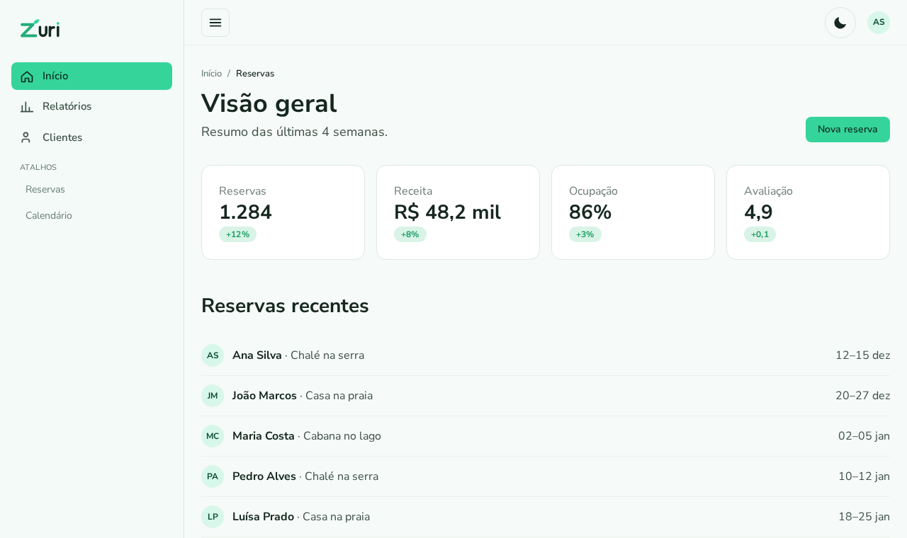
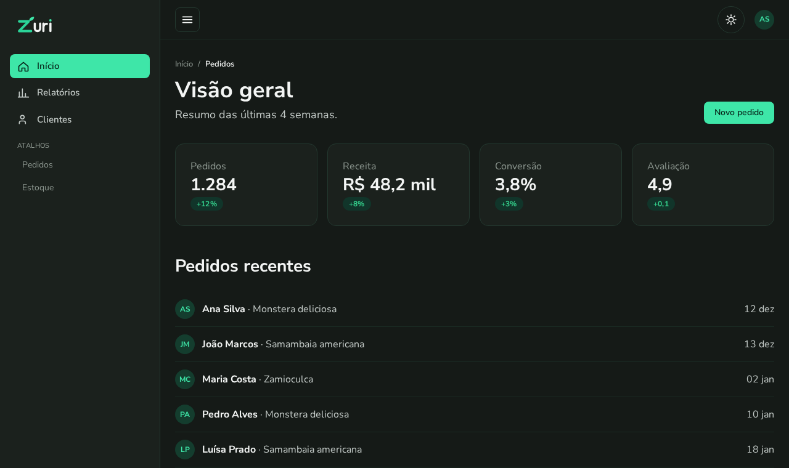
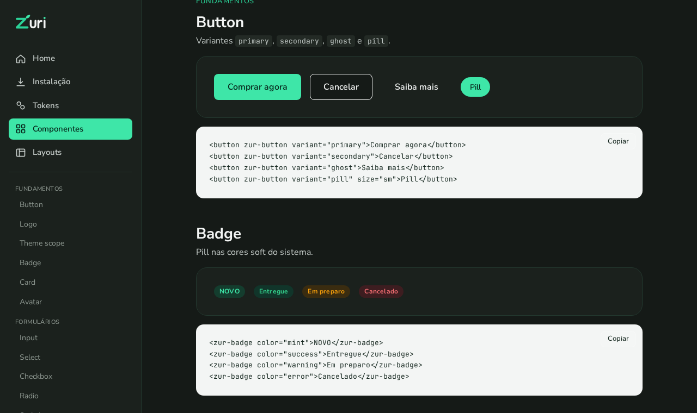
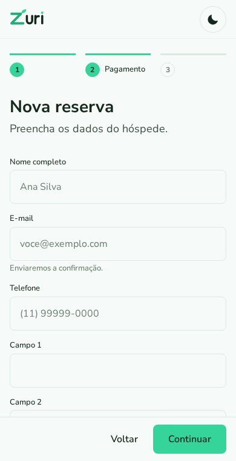

<div align="center">

<picture>
  <source media="(prefers-color-scheme: dark)" srcset="branding/zuri-horizontal-dark.svg">
  
</picture>

### Um design system amigável


[](https://www.npmjs.com/package/@juau/zuri)


[Documentação](https://joaomarcossc.github.io/Zuri/) · [Storybook](https://joaomarcossc.github.io/Zuri/storybook/) · [npm](https://www.npmjs.com/package/@juau/zuri)

</div>

<br>

<picture>
  <source media="(prefers-color-scheme: dark)" srcset="branding/screenshots/home-dark.png">
  
</picture>

Zuri é uma biblioteca de componentes e layouts para Angular. Tem uma cor de ação (um verde-menta), a fonte Nunito Sans, cantos de 8 a 14px e um único nível de sombra, usado só em elementos flutuantes. O tema escuro não é o claro invertido: tem fundo grafite com um toque de verde e degraus de elevação próprios.

Os componentes são standalone e usam `OnPush`. Os campos de formulário (`zur-input`, `zur-select`, `zur-checkbox`, `zur-radio`, `zur-switch`) implementam `ControlValueAccessor`, então funcionam com `ngModel` e formulários reativos.

O tema vem de CSS variables. O `zur-theme-toggle` alterna entre claro e escuro, guarda a escolha no `localStorage` e, na primeira visita, segue o `prefers-color-scheme` do sistema. Para trocar o tema só de um trecho da página, a diretiva `zurThemeScope` faz isso sem afetar o resto.

A documentação deste repositório foi feita com o próprio Zuri, então cada componente aparece funcionando, com o código ao lado.

## Veja em ação

Tudo abaixo está rodando na [documentação online](https://joaomarcossc.github.io/Zuri/), onde cada componente e cada layout tem demo ao vivo e o código ao lado. O [Storybook](https://joaomarcossc.github.io/Zuri/storybook/) tem o catálogo de componentes e uma story por layout.

<table>
  <tr>
    <td width="50%"><br><sub>Dashboard, tema claro. A sidebar recolhe e o topbar some ao rolar.</sub></td>
    <td width="50%"><br><sub>O mesmo Dashboard no tema escuro.</sub></td>
  </tr>
  <tr>
    <td width="50%"><br><sub>Página de componentes: demo ao vivo e código.</sub></td>
    <td width="50%" align="center"><br><sub>Formulário no mobile.</sub></td>
  </tr>
</table>

## Começando

O jeito mais rápido é o `ng add`, que instala o pacote e já configura os tokens, a fonte e o estilo base do `body`:

```bash
ng add @juau/zuri
```

Se preferir fazer à mão, instale com `npm install @juau/zuri` e importe os tokens e a fonte no `styles.css` global da aplicação:

```css
/* styles.css global da aplicação */
@import '@juau/zuri/styles/tokens.css';
@import url('https://fonts.googleapis.com/css2?family=Nunito+Sans:wght@400;500;600;700;800&display=swap');

body {
  margin: 0;
  background: var(--zur-canvas);
  color: var(--zur-body);
  font: var(--zur-font-body);
}
```

```ts
import { ZurButton, ZurBadge, ZurLogo } from '@juau/zuri';
```

```html
<zur-logo />
<zur-badge color="mint">Novo</zur-badge>
<button zur-button variant="primary" size="lg">Comprar agora</button>
```

Os textos internos dos componentes (rótulos de acessibilidade, "Voltar", "Fechar") vêm em português. Para inglês, use `provideZuriI18n('en')` nos providers da aplicação, ou passe só as chaves que quiser trocar.


## Rodando este repositório

Para ver a documentação e o Storybook localmente, ou para mexer na biblioteca:

```bash
git clone https://github.com/JoaoMarcosSC/Zuri.git
cd Zuri
npm install

npm start                 # documentação em http://localhost:4200
npm run storybook         # catálogo de componentes
npx ng build zuri         # compila a biblioteca para dist/zuri
```

## Componentes

| Grupo | Componentes |
|---|---|
| Tema e marca | `ZurThemeService`, `zur-theme-toggle`, `[zurThemeScope]`, `zur-logo` |
| Fundamentos | `button[zur-button]`, `zur-badge`, `zur-card`, `zur-avatar` |
| Formulários | `zur-input`, `zur-textarea`, `zur-select`, `zur-checkbox`, `zur-radio`, `zur-switch` |
| Navegação | `zur-navbar`, `zur-tabs`, `zur-menu`, `zur-breadcrumb`, `zur-sidenav` |
| Dados | `table[zur-table]` com `th[zurSortable]`, `zur-pagination` |
| Conteúdo | `zur-step`, `zur-accordion`, `zur-empty-state` |
| Feedback | `zur-modal`, `ZurToastService`, `[zurTooltip]`, `zur-alert`, `zur-spinner`, `zur-skeleton`, `zur-progress` |
| Sobreposição | `zur-drawer`, `zur-popover` com `[zurPopoverTrigger]` |

## Layouts de página

Cada layout resolve a estrutura da página, a largura do conteúdo, o comportamento no celular e o tema. Você só coloca o conteúdo dentro.

| Layout | Componente | Sidebar | Largura |
|---|---|---|---|
| Landing | `zur-landing-layout` | não | `wide`, ~1100px |
| Dashboard | `zur-dashboard-layout` | recolhível | `fluid` |
| Lista e detalhe | `zur-list-detail-layout` | não | `fluid` |
| Formulário e wizard | `zur-form-layout` | não | `reading`, ~760px |
| Documentação | `zur-docs-layout` | recolhível | `reading`, ~760px |
| Autenticação | `zur-auth-layout` | não | `narrow`, ~440px |
| Erro e 404 | `zur-error-layout` | não | `narrow`, ~440px |

Breadcrumb, cabeçalho de página e rodapé são opcionais: `zur-breadcrumb`, `zur-page-header` e `zur-footer`, junto com `zur-sidebar` e `zur-topbar`, entram por slot.

```html
<zur-dashboard-layout>
  <zur-sidebar>
    <zur-logo zurSidebarHeader variant="auto" />
    <zur-sidenav aria-label="Principal">
      <a zur-sidenav-item routerLink="/" routerLinkActive="active">Início</a>
    </zur-sidenav>
  </zur-sidebar>

  <zur-topbar>
    <ng-container zurTopbarActions><zur-theme-toggle /></ng-container>
  </zur-topbar>

  <zur-page-header title="Visão geral" />
</zur-dashboard-layout>
```

Se você não sabe qual layout usar, o [guia de decisão](LAYOUTS.md) cruza tipo de app, conteúdo e público. No Claude Code, o comando `/zuri-layout` faz essas perguntas, recomenda um layout e gera o esqueleto da página.

## Design

A especificação completa (cores, tipografia, espaçamento, elevação, componentes e layouts) está em [DESIGN.md](DESIGN.md). O guia de layouts é o [LAYOUTS.md](LAYOUTS.md). A pasta [branding](branding) tem o logo em SVG (horizontal e ícone, para fundo claro, escuro e com cores do tema) e o favicon.

## Estrutura

```text
.
├── projects/
│   ├── zuri/              biblioteca (ng-packagr) e Storybook
│   │   ├── src/lib/       componentes e layouts
│   │   ├── src/styles/    tokens.css, com os temas claro e escuro
│   │   └── src/stories/   stories do Storybook
│   └── docs/              documentação, feita com o próprio Zuri
├── branding/              logo, favicon e screenshots
├── .claude/commands/      comando /zuri-layout
├── DESIGN.md
└── LAYOUTS.md
```

A documentação lê a biblioteca de `dist/zuri`. Depois de mexer na biblioteca, rode `npx ng build zuri` ou deixe `npm run watch` aberto.

## Publicação da documentação

A documentação e o Storybook são publicados no GitHub Pages a cada push na `main`, pelo workflow [`deploy-docs.yml`](.github/workflows/deploy-docs.yml). Ele compila a biblioteca, a documentação e o Storybook, e leva uns 2 a 4 minutos. O site é estático e fica em `https://joaomarcossc.github.io/Zuri/`, então o `base href` é ajustado no build e o `404.html` reaproveita o `index.html` para as rotas funcionarem ao recarregar a página.

Para testar do mesmo jeito localmente:

```bash
npx ng build zuri
npx ng build docs --base-href /Zuri/
```

## Testes

Cada componente tem testes unitários ao lado do código (`*.spec.ts`), rodados com `npm test`. Além disso, toda story do Storybook roda como teste num navegador, com a checagem de acessibilidade do axe ligada: uma violação (contraste, botão sem nome, rótulo faltando) faz o teste falhar.

```bash
npm test               # testes unitários da biblioteca
npm run test:stories   # stories + acessibilidade (precisa do Chromium do Playwright)
```

O workflow [`ci.yml`](.github/workflows/ci.yml) roda tudo isso em cada push e pull request, e a documentação só é publicada se os testes passarem.

## Publicando uma versão

1. Atualize a versão em `projects/zuri/package.json` e registre as mudanças no [CHANGELOG](CHANGELOG.md).
2. Faça o commit e o push.
3. Crie uma Release no GitHub com a tag `v` + versão (ex.: `v0.1.0`).

O workflow [`release.yml`](.github/workflows/release.yml) confere se a tag bate com a versão, roda os testes, compila e publica no npm com provenance. A publicação usa o Trusted Publishing do npm (OIDC), então não há token nem secret no repositório: o GitHub prova a identidade do workflow, e o npm aceita porque o repositório e o arquivo `release.yml` estão cadastrados como publicador em `npmjs.com/package/@juau/zuri/access`.

## Scripts

| Comando | O que faz |
|---|---|
| `npm start` | Sobe a documentação em modo de desenvolvimento |
| `npx ng build zuri` | Compila a biblioteca para `dist/zuri` |
| `npm run build:lib` | Compila a biblioteca e o schematic do `ng add` (é o que vai para o npm) |
| `npm test` | Testes unitários |
| `npm run test:stories` | Testa as stories, incluindo acessibilidade |
| `npx ng build docs` | Compila a documentação para `dist/docs` |
| `npm run storybook` | Abre o Storybook |
| `npm run build-storybook` | Gera o Storybook estático |
| `npm run watch` | Recompila a biblioteca ao salvar |

## Nome e logo

Zuri quer dizer "bonito" em suaíli. As cores vêm dos tokens, então o logo muda junto com o tema.

## Licença

[MIT](LICENSE).
